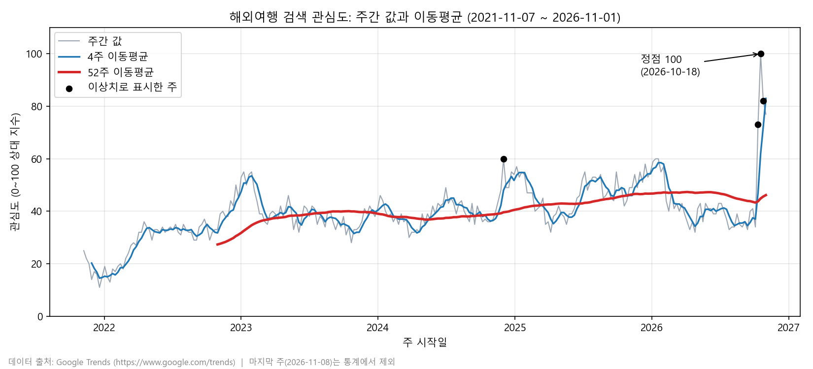
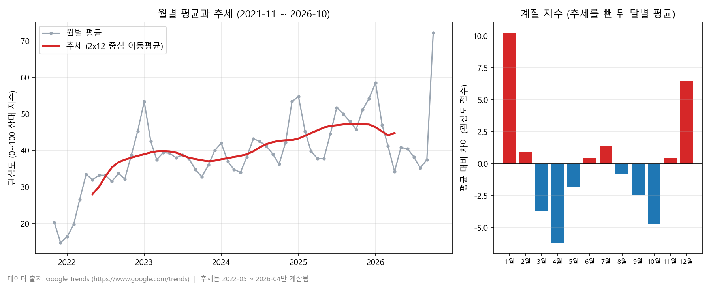
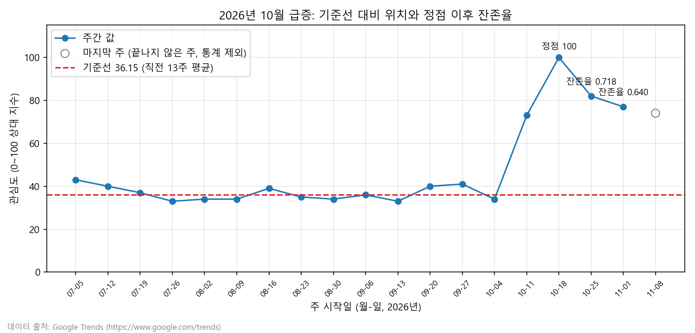

# 해외여행 검색 관심도 추이 분석 보고서 (작성 중)

이 문서는 단계마다 갱신한다. 현재 STEP 10(보너스)까지 작성했으며, 최종 점검이 남아 있다.

## 1. 주제

Google Trends의 "해외여행" 검색 관심도(대한민국, 최근 5년, 주간)로 장기 추세, 계절성, 최근 급증의 성격을 확인한다.

## 2. 분석 질문

| 번호 | 질문 | 사용할 기법 |
|---|---|---|
| Q1 | 5년간 관심도는 얼마나 늘었고 최근에도 계속 늘고 있는가 | 이동평균, 52주 묶음 평균과 증감률 |
| Q2 | 연중 관심이 높은 달과 낮은 달이 있는가 (계절성) | 월별 집계, 추세·계절성·잡음 분해 |
| Q3 | 2026년 10월 급증은 일시적인가 새로운 수준인가 | 전주 대비 변화율, 이상치 표시, 이동평균 |
| Q4 (보너스) | 단순 기준선 예측 중 무엇이 가장 정확하고, 그 기준선으로 보면 급증은 얼마나 큰가 | 기준선 예측 3종 백테스트, 평균 절대 오차(MAE) |

## 3. 데이터 설명

| 항목 | 내용 |
|---|---|
| 출처 | Google Trends (https://www.google.com/trends) |
| 수집일 | 2026-11-09 |
| 검색어, 지역 | 해외여행, 대한민국 |
| 기간 | 2021-11-07 ~ 2026-11-08 (주 시작일 기준) |
| 집계 단위 | 주간 (일요일 시작), 262개 |
| 값의 의미 | 0–100 상대 지수. 기간 내 최댓값이 100이며 실제 검색 횟수가 아니다 |
| 라이선스 | Google 서비스 약관 범위에서 사용하고 출처를 표기한다 (DATA_SOURCE.md 참고) |
| 외부 비교 자료 | 한국관광공사 한국관광 데이터랩 연도별 통계의 국민 해외관광객(월별). 공공누리 제1유형(출처표시). 5.4 교차검증에만 쓰고 본 분석 데이터에는 포함하지 않는다 |

수집 절차와 한계는 DATA_SOURCE.md에 있다.

## 4. 데이터 처리 파이프라인

처리 순서는 불러오기, 품질 점검, 마지막 주 제외, 이상치 표시, 저장이며 코드는 analysis.ipynb에 있다.

| 구분 | 기준 | 이유 |
|---|---|---|
| 결측치 | 있으면 채우지 않고 개수와 위치를 기록한다 | 상대 지수라 보간값은 근거가 약하다 |
| 마지막 주 | 통계에서 제외하고 원본 파일에는 유지한다 (262주에서 261주) | 수집일(2026-11-09)에 끝나지 않은 주일 수 있다 |
| 이상치 | 13주 이동 중앙값 기준 로버스트 z 점수 3.5 초과를 표시만 하고 삭제하지 않는다 | 급증이 실제 관심 변화일 수 있고, 추세가 있어 전체 분포 기준은 부적합하다. 창 13주는 임의 선택이라 5.4에서 민감도를 확인했다 |
| 집계 단위 | 주간을 기본으로 하고 월별 집계는 계절성 확인에만 쓴다 | 주간은 261개라 100개 이상 조건을 채우지만 월별은 약 60개라 채우지 못한다 |
| 월별 집계 | 각 주를 주 시작일이 속한 달에 넣고 평균을 낸다. 주가 4개 미만인 달은 뺀다 (2026-11, 1주) | 주가 걸치는 달 경계에서 배정 기준을 하나로 정하고, 주가 적은 달의 평균은 불안정하다 |

품질 점검 결과는 행 262개, 결측치 0, 중복 날짜 0, 주 간격 7일 유지, 값이 0인 주 0개, 값 범위 11–100이다.

이상치로 표시된 주는 4개이며 값은 아래와 같다.

| 날짜 | 값 | 13주 중앙값 | 로버스트 z 점수 |
|---|---|---|---|
| 2024-12-01 | 60 | 49.0 | 3.71 |
| 2026-10-11 | 73 | 40.5 | 10.96 |
| 2026-10-18 | 100 | 41.0 | 19.90 |
| 2026-10-25 | 82 | 57.0 | 8.43 |

전체 분포 기준(IQR)은 18개를 표시했고 그중 10개는 2021-11–2022-02의 초기 저점이었다. 추세 때문에 정상값이 이상치로 잡혀 채택하지 않았다. 이동 중앙값은 데이터 양 끝에서 창이 짧아져 판정이 덜 안정적이다. 맨 앞 주(2021-11-07)는 z 점수 2.698로 기준 미만이었다.

## 5. 분석 결과

### 5.1 Q1 장기 추세 (STEP 4)

사용한 기법은 이동평균과 52주 묶음 평균이다.

- 이동평균은 최근 N주의 평균을 한 주씩 밀며 구한 값이다. 주마다 흔들리는 잡음을 줄여 추세를 보여 준다.
- 4주 이동평균은 약 한 달의 짧은 흐름이다. 급증에 빠르게 반응한다.
- 52주 이동평균은 1년 평균이라 계절 변동이 상쇄되고 장기 추세만 남는다. 52주가 모이기 전인 처음 51주는 값이 없으며 채우지 않았다 (첫 계산일 2022-10-30).
- 달력 연도는 2021년이 8주, 2026년이 45주라 연도별 비교가 불공평하다. 첫 주를 빼고 52주씩 5묶음으로 나눠 비교했다.

52주 묶음별 결과는 아래와 같다.

| 묶음 | 기간 | 평균 | 중앙값 | 최댓값 | 이상치 수 | 증감률 | 이상치 제외 평균 | 이상치 제외 증감률 |
|---|---|---|---|---|---|---|---|---|
| 1 | 2021-11-14 ~ 2022-11-06 | 27.62 | 32.0 | 39 | 0 | | 27.62 | |
| 2 | 2022-11-13 ~ 2023-11-05 | 39.83 | 39.0 | 55 | 0 | +44.22% | 39.83 | +44.22% |
| 3 | 2023-11-12 ~ 2024-11-03 | 38.81 | 39.0 | 49 | 0 | -2.56% | 38.81 | -2.56% |
| 4 | 2024-11-10 ~ 2025-11-02 | 46.23 | 46.5 | 60 | 1 | +19.13% | 45.96 | +18.43% |
| 5 | 2025-11-09 ~ 2026-11-01 | 46.15 | 41.0 | 100 | 3 | -0.17% | 43.78 | -4.75% |

52주 이동평균은 처음 27.35(2022-10-30)에서 최고 47.35(2026-04-05)까지 올랐다. 2026-09-27에는 43.58로 최고점보다 8.0% 낮았고, 급증이 반영된 2026-11-01에는 46.15였다.

사실:
- 1묶음 대비 5묶음 평균은 67.1% 높다 (27.62에서 46.15).
- 증가는 2묶음(+44.22%)과 4묶음(+19.13%)에서 일어났고, 3묶음(-2.56%)과 5묶음(-0.17%)은 정체였다.

해석 (추정):
- 관심도는 5년간 크게 올랐고 2025년 이후에는 오르지 않고 정체한 것으로 보인다.

반례:
- 5묶음 평균 46.15는 2026-10의 급증 3주(73, 100, 82)가 끌어올린 값이다. 이 3주를 빼면 43.78이고 4묶음 대비 -4.75%다. 급증을 포함하면 정체로 보이고 제외하면 소폭 하락이다.
- 급증이 일시적인지 새로운 수준인지는 이 단계에서 판단하지 않고 Q3에서 다룬다.

한계:
- 급증 이후 데이터가 3주뿐이라 5묶음의 마지막 구간은 불안정하다.
- 상대 지수라 실제 검색 횟수의 증가율과 같다고 볼 수 없다.
- 실제 출국자 통계와 증가 시기가 다르다 (5.4 참고).

### 5.2 Q3 2026년 10월 급증의 성격 (STEP 5)

사용한 기법은 전주 대비 변화(변화폭과 변화율), 기준선 비교, 정점 이후 잔존율, 과거 사례 비교다.

- 전주 대비 변화는 이번 주 값에서 지난주 값을 뺀 값이고, 변화율은 그 차이를 지난주 값으로 나눈 비율이다.
- 기준선은 급증 직전 13주(2026-07-12 ~ 2026-10-04)의 평균 36.15로 정했다. 평균 대신 쓸 수 있는 중앙값은 35.0으로 비슷했다.
- 잔존율은 (그 주 값 - 기준선) / (정점 값 - 기준선)이다. 1이면 정점 그대로, 0이면 기준선으로 복귀한 것이다. 이 보고서에서 정의한 지표이며 표준 용어가 아니다.

전주 대비 변화는 아래와 같다.

| 날짜 | 값 | 변화 | 변화율 |
|---|---|---|---|
| 2026-10-04 | 34 | -7.0 | -17.07% |
| 2026-10-11 | 73 | +39.0 | +114.71% |
| 2026-10-18 | 100 | +27.0 | +36.99% |
| 2026-10-25 | 82 | -18.0 | -18.00% |
| 2026-11-01 | 77 | -5.0 | -6.10% |

주간 변화율의 평균은 1.2%, 표준편차는 13.32%다(260주). 변화폭이 큰 상위 5주는 2026-10-11(+39), 2026-10-18(+27), 2026-10-25(-18), 2026-02-08(-13), 2024-12-01(+12)이다.

정점 이후 잔존율은 아래와 같다.

| 날짜 | 값 | 기준선 초과분 | 잔존율 | 비고 |
|---|---|---|---|---|
| 2026-10-18 | 100 | 63.85 | 1.000 | 정점 |
| 2026-10-25 | 82 | 45.85 | 0.718 | |
| 2026-11-01 | 77 | 40.85 | 0.640 | |
| 2026-11-08 | 74 | 37.85 | 0.593 | 미완성 가능, 통계 제외 (참고용) |

사실:
- 변화폭 상위 3주가 모두 2026-10의 급증이다. 10-11의 변화율 +114.71%는 평소 주간 변화율의 표준편차(13.32%)의 약 8.5배다.
- 급증 후 4주 평균 83.0은 기준선 36.15의 2.30배다.
- 정점 이후 3주가 지난 2026-11-01의 잔존율은 0.640이다.
- 2024-12-01 이상치(60) 전후를 비교하면 급증 전 4주 평균 42.25, 급증 후 8주 평균 53.25이고 잔존율은 0.62다.

해석 (추정):
- 관심도는 정점 이후 내려가고 있으나 기준선으로 돌아오지 않았다. 올라간 폭의 약 64%가 3주 뒤에도 남아 있다.
- 2024-12에도 급증 후 수준이 급증 전보다 높게 유지됐다. 이번 급증도 일부는 남을 가능성이 있다.

반례와 한계:
- 비교 사례는 1건이고 규모가 다르다(정점 60 대 100). 당시에는 상승 추세 중이었으므로 근거로 약하다.
- 급증 후 관측이 3주뿐이라 일시적인지 새로운 수준인지 단정할 수 없다. 이후 주 데이터를 추가 수집해야 한다.
- 변화율은 기준값이 작을 때 크게 나온다. 10-11의 +114.71%는 34에서 73으로 오른 값이며, 변화폭(+39)과 함께 읽어야 한다.
- 급증의 원인은 이 데이터에 없으므로 추정하지 않는다.
- 이상치 판정은 규칙에 따라 달라질 수 있으나 급증 첫 두 주(10-11, 10-18)는 12개 설정 모두에서 검출됐다 (5.4 참고).
- 기준선 길이(13주)와 잔존율 정의는 AI가 제안한 선택이며 길이를 바꿔 본 민감도 검증은 하지 않았다.

### 5.3 Q2 계절성 (STEP 6)

사용한 기법은 월별 집계와 고전적 가법 분해다.

- 월별 집계는 각 주를 주 시작일이 속한 달에 넣고 달별 평균을 낸 것이다. 주가 4개 미만인 2026-11을 빼 2021-11 ~ 2026-10의 60개월이 됐다. 달별 주 수는 4주 40개월, 5주 20개월이다.
- 분해는 값을 추세 + 계절 + 잡음으로 나눈다. 추세는 2x12 중심 이동평균(12개월 이동평균을 한 번 더 평균한 것)으로 구했고, 앞뒤 6개월은 계산할 수 없어 2022-05 ~ 2026-04의 48개월에서만 값이 있다.
- 계절 지수는 추세를 뺀 값을 같은 달끼리 평균하고 전체 평균이 0이 되도록 맞춘 값이다. 달마다 4개 값의 평균이다.
- 계절성 강도는 1 - (잡음의 분산 / (계절 + 잡음)의 분산)이다. 0에 가까우면 계절성이 약하고 1에 가까우면 강하다.

계절 지수는 아래와 같다.

| 월 | 계절 지수 | 월 | 계절 지수 |
|---|---|---|---|
| 1월 | +10.25 | 7월 | +1.36 |
| 2월 | +0.93 | 8월 | -0.80 |
| 3월 | -3.76 | 9월 | -2.49 |
| 4월 | -6.19 | 10월 | -4.77 |
| 5월 | -1.81 | 11월 | +0.43 |
| 6월 | +0.41 | 12월 | +6.44 |

계절성 강도는 0.734이고 잡음의 표준편차는 2.69다.

연도별 최고·최저 달은 아래와 같다.

| 연도 | 달 수 | 최고 달 | 최고 값 | 최저 달 | 최저 값 |
|---|---|---|---|---|---|
| 2021 | 2 | 11월 | 20.25 | 12월 | 14.75 |
| 2022 | 12 | 12월 | 45.25 | 1월 | 16.40 |
| 2023 | 12 | 1월 | 53.40 | 10월 | 32.80 |
| 2024 | 12 | 12월 | 53.40 | 4월 | 34.00 |
| 2025 | 12 | 1월 | 54.75 | 4월 | 37.75 |
| 2026 | 10 | 10월 | 72.25 | 4월 | 34.25 |

사실:
- 계절 지수는 1월(+10.25)과 12월(+6.44)이 가장 높고 4월(-6.19)과 10월(-4.77)이 가장 낮다.
- 완전한 해(2022–2025) 4개 모두 최고 달이 12월 또는 1월이다.
- 최저 달은 2023년 10월, 2024년과 2025년 4월이다. 2026년은 10개월 중 4월이 가장 낮다.
- 2022–2025년의 10월 월평균은 모두 9월보다 낮았다(-1.55, -1.95, -2.75, -2.25점). 2026년 10월은 9월보다 34.75점 높았다.

해석 (추정):
- 관심도는 12–1월에 높고 4월과 10월에 낮아지는 계절 패턴이 있는 것으로 보인다. 겨울 휴가철과 관련 있을 수 있으나 이 데이터만으로 원인을 확인할 수 없다.
- 예년의 10월은 9월보다 2점 안팎 낮았는데 2026-10의 월평균 72.25는 9월(37.50)보다 34.75 높다. 계절 지수 범위(-6.19 ~ +10.25)로도 설명되기 어렵다. 이 급증은 계절 요인이 아니라는 쪽에 가깝다.
- 10월이 "검색이 가장 적은 달"이라는 뜻은 아니다. 10월이 그해 가장 낮았던 해는 2023년 한 번이고, 2022년과 2025년에는 12개월 중 6번째였다.

반례와 한계:
- 2022년 최저 달이 1월(16.40)로 나온 것은 계절 때문이 아니다. 시계열 초반에 관심도 자체가 낮았던 추세 영향이다. 연도별 최고·최저 달 표만으로는 이 차이를 구분할 수 없어 계절 지수와 함께 읽어야 한다.
- 2021년은 2개월, 2026년은 10개월뿐이라 연도별 비교에서 제외하거나 따로 읽어야 한다.
- 추세가 계산되는 구간이 48개월뿐이고 계절 지수는 달마다 4개 값의 평균이라 표본이 작다.
- 2026-05 이후 6개월은 추세가 없어 분해하지 못했다. 2026-10 급증은 분해 결과에 포함되지 않는다.
- 월별 60개는 과제 기준 100개 미만이라 계절성 확인용 보조 자료로만 쓴다.
- 12–1월이 높고 4월이 낮다는 패턴은 실제 출국자 통계와 일치하지만 10월은 일치하지 않는다 (5.4 참고).

### 5.4 검증: 민감도, 독립 재계산, 외부 교차검증 (STEP 8-2 ~ 8-4)

AI가 정한 선택과 AI가 계산한 값을 그대로 믿지 않기 위해 세 가지 검증을 했다. 코드는 analysis.ipynb의 마지막 셀들에 있다.

#### 민감도 검증 (이상치 규칙)

이상치 규칙의 창 길이(9, 13, 17, 26주)와 임계값(3.0, 3.5, 4.0)을 바꿔 같은 규칙을 12번 실행했다. 이상치로 표시된 주의 개수는 아래와 같다.

| 창 (주) | 임계 3.0 | 임계 3.5 | 임계 4.0 |
|---|---|---|---|
| 9 | 4 | 3 | 2 |
| 13 (채택) | 4 | 4 | 3 |
| 17 | 10 | 7 | 4 |
| 26 | 9 | 4 | 4 |

핵심 4주가 12개 설정 중 몇 개에서 검출됐는지는 아래와 같다.

| 날짜 | 검출 횟수 | 검출되지 않은 설정 |
|---|---|---|
| 2026-10-11 | 12 / 12 | 없음 |
| 2026-10-18 | 12 / 12 | 없음 |
| 2026-10-25 | 9 / 12 | 창 9 (임계값 3개 모두) |
| 2024-12-01 | 7 / 12 | 임계 4.0의 모든 창, 창 26의 임계 3.5 |

사실:
- 이상치 개수는 설정에 따라 2개에서 10개까지 달라진다. 채택한 설정(창 13, 임계 3.5)의 4개는 이 범위 안에 있다.
- 급증 첫 두 주는 모든 설정에서 검출되고 10-25는 창 9에서만 빠진다.
- 2024-12-01은 설정에 따라 검출 여부가 갈린다.

해석 (추정):
- 2026-10 급증이 이상치라는 판단은 규칙 선택에 흔들리지 않는다. 2024-12 급증은 이상치로 단정하지 않는다.

결정:
- 창 13주를 유지한다. 근거는 급증 3주가 창 13에서 모두 검출되고 개수가 설정 범위의 중간에 있다는 점이다. 창 길이 자체는 문헌에 없는 선택이므로 AI 제안에서 출발했다는 점을 9장 결정 로그에 남겼다.

#### 독립 재계산

코드와 다른 도구(PowerShell Import-Csv)로 핵심 값을 data/weekly_clean.csv에서 다시 계산했다.

| 항목 | 노트북 값 | 재계산 값 | 결과 |
|---|---|---|---|
| 행 수 | 261 | 261 | 일치 |
| 1묶음 평균 (2021-11-14 ~ 2022-11-06) | 27.62 | 27.6154 | 일치 |
| 5묶음 평균 (2025-11-09 ~ 2026-11-01) | 46.15 | 46.1538 | 일치 |
| 기준선 (2026-07-12 ~ 2026-10-04) | 36.15 | 36.1538 | 일치 |
| 정점 | 2026-10-18, 100 | 2026-10-18, 100 | 일치 |
| 잔존율 2026-10-25 | 0.718 | 0.7181 | 일치 |
| 잔존율 2026-11-01 | 0.640 | 0.6398 | 일치 |

이 검증은 계산이 맞는지만 확인한다. weekly_clean.csv가 원본과 같은지, 기준선 구간 선택이 적절한지는 확인하지 않는다.

#### 외부 교차검증 (한국관광공사 월별 국민 해외관광객)

한국관광공사 한국관광 데이터랩의 연도별 통계(공공누리 제1유형, 출처표시) 중 국민 해외관광객 월별 시트로 비교했다. 이 자료는 법무부 출입국 자료 기반의 실제 출국자 수이고, Google Trends는 검색 관심도라 지표가 다르다. 값이 아니라 패턴과 방향만 비교한다. 월 합계와 연 합계의 차이는 2021–2025년 모두 0이었다. 시트의 2025년 성장률 칸(30.09)은 총계로 계산한 값(3.01%)과 달라 사용하지 않았다.

계절성은 2024–2025년의 월 값을 그해 월평균으로 나눈 비율의 평균과 우리 계절 지수를 비교했다. 2022–2023년은 코로나 회복기로 연 증가율이 +436.1%와 +246.6%라 월별 값이 추세에 끌려가므로 뺐다.

| 월 | 실제 출국자 비율 | 우리 계절 지수 |
|---|---|---|
| 1월 | 1.183 | +10.25 |
| 2월 | 1.059 | +0.93 |
| 3월 | 0.894 | -3.76 |
| 4월 | 0.878 | -6.19 |
| 5월 | 0.960 | -1.81 |
| 6월 | 0.916 | +0.41 |
| 7월 | 1.018 | +1.36 |
| 8월 | 0.985 | -0.80 |
| 9월 | 0.938 | -2.49 |
| 10월 | 1.042 | -4.77 |
| 11월 | 1.001 | +0.43 |
| 12월 | 1.126 | +6.44 |

상관은 Pearson 0.836, Spearman 0.748이다. 두 지표 모두 1월과 12월이 높고 4월이 가장 낮다. 10월은 실제 출국자가 평균보다 높은 반면(1.042) 우리 지수는 낮은 달(-4.77)이다.

증가 추세는 우리 52주 묶음과 맞추기 위해 11월부터 10월까지를 한 구간으로 묶어 비교했다. 우리 묶음은 2021-11-14 ~ 2022-11-06처럼 52주 단위라 구간이 약간 어긋난다.

| 구간 (11월 ~ 10월) | 실제 출국자 합계 | 실제 증가율 | 우리 52주 평균 증가율 |
|---|---|---|---|
| 2021-11 ~ 2022-10 | 4,406,590 | | |
| 2022-11 ~ 2023-10 | 20,673,202 | +369.1% | +44.22% |
| 2023-11 ~ 2024-10 | 28,056,570 | +35.7% | -2.56% |
| 2024-11 ~ 2025-10 | 29,442,661 | +4.9% | +19.13% |

사실:
- 계절 패턴의 큰 틀(12–1월 높음, 4월 낮음)은 두 지표가 같다.
- 10월은 두 지표가 다르다.
- 실제 출국자는 2024년까지 늘다가 이후 증가율이 +4.9%로 낮아졌다. 검색 관심도는 2023년에 정체했고 2024-11 ~ 2025-10 구간에서 +19.13% 올랐다. 증가율이 바뀌는 시점이 다르다.

해석 (추정):
- 검색 관심도는 상대 지수라 실제 출국자 증가와 시기가 다를 수 있다. 이 데이터로 원인은 확인하지 못했다.
- 10월 불일치는 실제 출국이 많았던 달(연휴 등)과 검색이 늘어나는 시기가 다르기 때문일 수 있다. 확인하지 않은 가설이다.

한계:
- 비교한 두 지표의 정의가 다르다. 상관이 높아도 같은 현상을 측정한다는 뜻은 아니다.
- 월별 12개 값의 상관이라 표본이 작다. 비교에 쓴 해는 2024–2025년 2개뿐이다.
- 2026년 월별 값은 사이트에서 2026-09까지 조회되지만 이 비교에는 쓰지 않았다. 2026-10 급증은 공표 전이라 실제 출국자와 비교하지 못했다.

### 5.5 Q4 기준선 예측 (보너스, STEP 10)

단순한 예측 방법 3개를 과거 13주에 시험해(백테스트) 가장 정확한 방법을 고르고, 그 기준선으로 급증 크기를 쟀다.

- 맞혀 볼 기간은 급증 직전 13주(2026-07-12 ~ 2026-10-04)이고, 그 전 데이터(2026-07-05까지)만 보고 예측했다. 이 13주에는 이상치가 없다.
- 직전값: 마지막 주 값(43)이 계속된다고 본다.
- 13주 평균: 최근 13주 평균(39.23)이 계속된다고 본다.
- 작년 같은 주: 52주 전 값이 반복된다고 본다. 계절을 반영하는 방법이다.
- 평균 절대 오차(MAE)는 예측과 실제의 차이를 부호 없이 평균한 값이며 작을수록 정확하다.

| 방법 | MAE |
|---|---|
| 직전값 | 6.85 |
| 13주 평균 | 3.59 |
| 작년 같은 주 | 13.23 |

가장 정확한 13주 평균을 급증 직전 시점(2026-10-04)에 다시 적용하면 기준선은 36.15다. 5.2의 기준선과 같은 값이다. 급증 4주와 이 기준선의 차이는 아래와 같다.

| 날짜 | 값 | 기준선 대비 차이 |
|---|---|---|
| 2026-10-11 | 73 | +36.85 |
| 2026-10-18 | 100 | +63.85 |
| 2026-10-25 | 82 | +45.85 |
| 2026-11-01 | 77 | +40.85 |

사실:
- 급증 전 13주에는 13주 평균이 가장 정확했다(MAE 3.59).
- 작년 같은 주는 13주 모두 실제보다 높게 예측했고 평균 13.23점 빗나갔다. 2025년 같은 주 값(44–55)이 2026년(33–41)보다 높았다.
- 급증 4주는 기준선보다 36.85–63.85점 높았다. 급증 전 MAE(3.59)의 10배 이상이다.

해석 (추정):
- 이 기간의 관심도는 작년 같은 시기보다 최근 수준에 더 가깝게 움직였다.
- 급증의 크기는 평소 예측 오차로 설명할 수 있는 범위를 크게 넘는다.

한계:
- 시험한 기간은 13주 한 번뿐이다. 다른 기간에서는 순위가 달라질 수 있다.
- 미래 값은 예측하지 않았다. 작년 같은 주 방법이 평균 13점 빗나갔고, 급증이 이어질지 알 수 없어 숫자를 내면 근거가 약하다.
- 세 방법 모두 단순 기준선이며 추세나 이상치를 따로 다루지 않는다.

## 6. 시각화

그림 3개를 images 폴더에 PNG(150dpi)로 저장했다. 모든 그림에 데이터 출처(Google Trends)를 적었다. 한글은 Malgun Gothic 글꼴로 그렸으며, analysis.ipynb를 실행하면 같은 파일이 다시 만들어진다.

### 그림 1. 주간 값과 이동평균 (Q1, Q3)

회색은 주간 값, 파란색은 4주 이동평균, 빨간색은 52주 이동평균이고 검은 점은 이상치로 표시한 4주다. 마지막 주(2026-11-08)는 통계에서 제외해 그리지 않았다.

- 52주 이동평균은 약 27(2022-10-30)에서 47.35(2026-04-05)까지 올랐고 이후 2026-09-27의 43.58까지 내려갔다. 2025년 이후 오르지 않는 정체 구간이 보인다.
- 2024-12-01(60)을 제외한 검은 점 3개는 모두 2026-10에 몰려 있다. 4주 이동평균만 급하게 따라 올라가고 52주 이동평균은 46.15까지만 움직여, 급증이 장기 추세를 크게 바꾸지는 못했다.

### 그림 2. 월별 평균, 추세, 계절 지수 (Q2)

왼쪽은 월별 평균(회색)과 추세(빨간색, 2022-05 ~ 2026-04)다. 오른쪽은 12개월의 계절 지수이며 0보다 높으면 빨간색, 낮으면 파란색이다.

- 1월(+10.25)과 12월(+6.44)이 높고 4월(-6.19)과 10월(-4.77)이 낮다.
- 왼쪽 맨 끝의 2026-10(72.25)은 추세선이 끝난 뒤에 있어 분해 결과로 설명되지 않는다. 예년의 10월은 9월보다 약간 낮았다는 점(5.3)과 함께 보면 이 급증은 계절 요인으로 보기 어렵다.

### 그림 3. 2026년 10월 급증 확대 (Q3)

2026-07-05부터의 주간 값이다. 빨간 점선은 급증 직전 13주 평균인 기준선(36.15)이고, 속이 빈 회색 원은 통계에서 제외한 마지막 주(74)다.

- 7–9월은 33–43 사이에서 기준선 근처에 머물다가 10-11(73), 10-18(100)로 올랐다.
- 정점 이후 잔존율은 10-25에 0.718, 11-01에 0.640으로 내려가고 있으나 기준선으로는 돌아오지 않았다. 이후 주의 값이 없어 일시적인지 새 수준인지는 판단하지 않는다.

그래프의 한계:
- 세로축은 0–100 상대 지수이며 실제 검색 횟수가 아니다.
- 그림 1과 그림 2는 시간 범위와 집계 단위(주간, 월간)가 달라 세로축 값을 직접 비교하지 않는다.

## 7. 통찰

각 통찰은 사실(Fact), 이유(Why), 행동(Action), 반례 순서로 쓴다. 행동의 대상은 여행·관광 마케터다. 검색 관심도는 실제 예약이나 매출과 같지 않다.

근거 라벨은 세 가지다.
- [데이터 근거]: 이 보고서의 계산 결과다.
- [외부 근거]: 한국관광공사 통계와 대조한 결과다 (5.4).
- [AI 가정]: AI가 제안했고 이 데이터로 확인하지 않은 가설이나 판단이다. 이유 항목은 모두 여기에 해당한다.

| 번호 | 통찰 | 핵심 숫자 | 행동 |
|---|---|---|---|
| 1 | 12–1월이 성수기, 4월이 비수기 (10월은 외부 통계와 불일치) | 계절 지수 1월 +10.25, 4월 -6.19, 실제 출국자와 상관 0.836 | 11월까지 준비를 끝내고 12–1월에 집행 |
| 2 | 2026-10 급증은 계절이 아니며 3주 뒤에도 64%가 남음 | 기준선의 2.30배, 잔존율 0.640 | 계절 보정 후 8주간 주별 잔존율 기록, 2024-12와 비교 |
| 3 | 관심도는 5년간 올랐으나 최근 정체, 실제 출국자와 증가 시기가 다름 | 5년 +67.1%, 최근 1년 -0.17%, 출국자 2023-11 ~ 2024-10 +35.7% | 관심도만으로 수요를 판단하지 않고 실제 지표와 함께 본다 |

### 통찰 1. 관심은 12–1월에 몰리므로 캠페인 준비는 11월 전에 끝낸다

사실:
- [데이터 근거] 계절 지수는 1월 +10.25, 12월 +6.44로 가장 높고 4월 -6.19, 10월 -4.77로 가장 낮다. 1월과 4월의 격차는 16.44점이다. 계절성 강도는 0.734다.
- [데이터 근거] 완전한 해 2022–2025년 4개 모두 최고 달이 12월(2022, 2024) 또는 1월(2023, 2025)이다.
- [데이터 근거] 4년 모두 12월 월평균이 11월보다 높다 (+6.50, +4.00, +11.15, +3.05점).
- [외부 근거] 2024–2025년 실제 출국자 월별 비율은 1월 1.183, 12월 1.126으로 높고 4월 0.878로 가장 낮다. 우리 계절 지수와 상관은 Pearson 0.836, Spearman 0.748이다.

이유:
- [AI 가정] 연말연시와 겨울 휴가철에 해외여행을 계획하는 사람이 늘어 검색이 늘었을 수 있다. 이 데이터로 원인을 확인할 수 없다.

행동:
- 콘텐츠와 프로모션은 12월 상승 전인 10–11월에 준비를 마치고 12–1월에 집행한다.
- 4월은 새 캠페인보다 콘텐츠 제작과 성과 점검에 시간을 쓴다. 10월은 아래 반례 때문에 비수기로 단정하지 않는다.
- 확인 방법: 2026-12 ~ 2027-01 월평균이 추세 대비 계절 지수만큼(12월 약 +6, 1월 약 +10점) 오르는지 본다.

반례:
- 10월은 두 지표가 다르다. 우리 계절 지수는 -4.77(낮은 달)인데 실제 출국자 비율은 1.042(평균 이상)다. 검색이 적은 달에도 출국은 많을 수 있다.
- 2026-10 월평균은 72.25로 이번 해 가장 높다. 계절 패턴이 항상 성립하지는 않는다.
- 2022년의 최저 달이 1월(16.40)로 나온 것은 계절 때문이 아니라 시계열 초반의 낮은 수준(추세) 때문이다.
- 계절 지수는 달마다 4개 값의 평균이고, 외부 통계 비교는 2024–2025년 2개 해뿐이라 표본이 작다.

### 통찰 2. 2026-10 급증은 계절이 아니고 3주 뒤에도 64%가 남아 있어 8주간 계절을 빼고 지켜본다

사실:
- [데이터 근거] 2026-10-11 주에 34에서 73으로 +39(+114.71%) 올랐다. 이는 평소 주간 변화율 표준편차(13.32%)의 약 8.5배다.
- [데이터 근거] 급증 후 4주 평균 83.0은 기준선 36.15의 2.30배다.
- [데이터 근거] 2022–2025년의 10월은 모두 9월보다 1.55–2.75점 낮았는데 2026년 10월은 9월보다 34.75점 높았다(월평균 72.25). 계절 지수 범위(-6.19 ~ +10.25)로도 설명되지 않는다.
- [데이터 근거] 정점(2026-10-18) 이후 잔존율은 0.718(10-25), 0.640(11-01)이다. 2024-12 급증 전후의 8주 평균 잔존율은 0.62였다.
- [데이터 근거] 급증 첫 두 주는 이상치 규칙 12개 설정 모두에서 검출됐다 (5.4).

이유:
- [AI 가정] 계절이 아닌 다른 요인이 있었을 가능성이 크다. 어떤 요인인지는 이 데이터에서 알 수 없다.
- [AI 가정] 정점 이후 내려가고 있으나 기준선으로 돌아오지 않았다.

행동:
- 급증 원인을 뉴스, 항공 노선, 환율 같은 외부 정보와 대조해 확인한다.
- 2026-10 이후의 성과를 평가할 때 급증 기간(2026-10-11 ~)은 평소 수준이 아니므로 기준선(36.15)을 그대로 비교 기준으로 쓰지 않는다.
- 이후 8주(2027-01-03까지) 주별 잔존율을 기록한다. 12–1월은 계절 상승이 겹치므로 계절 지수(12월 +6.44, 1월 +10.25)를 뺀 값으로 계산한다.
- 2024-12 급증 이후도 같은 방식으로 주별 잔존율을 계산해 두 곡선을 나란히 본다. 현재 2024-12 사례는 8주 평균 0.62 한 값뿐이다.
- 일시적인지 새 수준인지를 가르는 기준값은 두지 않는다. 예전 초안의 0.5 기준은 AI가 제안한 값이었고 근거가 없어 삭제했다.
- 실제 출국자 통계에서 2026-10이 공표되면 급증이 실제 출국 증가와 같이 나타났는지 확인한다. 공표 시점은 확인하지 않았다.

반례:
- 정점 이후 관측이 3주뿐이라 일시적 급증인지 새 수준인지 결론 내릴 수 없다.
- 비교 사례는 2024-12 한 건이고 규모가 다르다(정점 60 대 100). 당시에는 상승 추세 중이었다.
- 2026-11-08 값(74)은 수집일에 끝나지 않은 주일 수 있어 판단에 쓰지 않았다.
- 기준선 길이와 잔존율 정의는 AI가 제안한 선택이며 민감도를 확인하지 않았다.

### 통찰 3. 관심도는 5년간 올랐으나 최근 정체이고 실제 출국자와 시기가 다르므로 관심도만으로 수요를 판단하지 않는다

사실:
- [데이터 근거] 52주 묶음 평균은 1묶음 27.62에서 5묶음 46.15로 5년간 67.1% 올랐다.
- [데이터 근거] 증가는 2묶음(+44.22%)과 4묶음(+19.13%)에서 일어났고 3묶음(-2.56%)과 5묶음(-0.17%)은 정체였다.
- [데이터 근거] 52주 이동평균은 최고 47.35(2026-04-05)에서 급증 직전(2026-09-27) 43.58로 8.0% 낮아졌다.
- [외부 근거] 실제 출국자는 2023-11 ~ 2024-10에 +35.7%, 2024-11 ~ 2025-10에 +4.9% 늘었다. 같은 구간에서 우리 52주 평균은 -2.56%와 +19.13%였다.

이유:
- [AI 가정] 시계열 시작 시점의 수준이 낮아(2021-11 ~ 2022-02 월평균 14.75 ~ 20.25, 평균 약 17.8) 초기 증가율이 커 보였을 수 있다. 이후에는 40대 중반에서 오르지 않고 머물렀다.
- [AI 가정] 검색 관심도는 상대 지수라 실제 출국자 수와 증가 시기가 다를 수 있다.

행동:
- 관심도 목표는 2025–2026년 수준(52주 평균 약 44–47)이 유지된다는 정체 가정을 기본으로 세운다.
- 수요 증감을 판단할 때 검색 관심도 하나에 의존하지 않고 출국자 수 같은 실제 지표와 함께 본다.
- 관심도 자체가 자연스럽게 늘 것이라는 가정에 기대지 않고, 채널과 타깃 확대처럼 점유를 늘리는 전략을 함께 둔다.

반례:
- 실제 출국자와 관심도의 증가 시기가 다르다. 2023-11 ~ 2024-10에 출국자는 +35.7% 늘었는데 관심도 52주 평균은 -2.56%였다. 관심도가 정체해도 실제 수요가 늘 수 있다.
- 5묶음 평균(46.15)은 급증 3주가 끌어올린 값이다. 이 3주를 빼면 43.78이고 4묶음 대비 -4.75%다. 포함하면 정체, 제외하면 소폭 하락으로 읽힌다.
- 2026-10 급증이 이어지면 이 정체 결론은 바뀔 수 있다. 이 통찰은 2026-10 이전 데이터를 기준으로 한다.
- 실제 출국자 통계는 2025년까지만 비교했다. 2025-11 이후 구간은 비교하지 못했다.

## 8. 결론과 한계

### 결론

- Q1 장기 추세: 52주 묶음 평균은 5년간 27.62에서 46.15로 67.1% 올랐다. 2025년 이후에는 거의 변하지 않았다(-0.17%). 급증 3주를 빼면 43.78로 직전 묶음보다 4.75% 낮다.
- Q2 계절성: 관심도는 12–1월에 높고 4월에 가장 낮다(계절 지수 1월 +10.25, 4월 -6.19, 계절성 강도 0.734). 실제 출국자 통계(2024–2025년)와 월별 패턴이 비슷하다(Pearson 0.836, Spearman 0.748). 10월만 다르다.
- Q3 2026-10 급증: 급증 후 4주 평균은 기준선의 2.30배다. 2022–2025년의 10월은 모두 9월보다 1.55–2.75점 낮았는데 2026년 10월은 34.75점 높아, 예년의 계절 패턴으로 설명되지 않는다. 정점 3주 뒤 올라간 폭의 64%가 남아 있다(잔존율 0.640). 관측이 3주뿐이라 일시적인지 새 수준인지는 판단하지 않았다.
- Q4 기준선 예측(보너스): 급증 전 13주 백테스트에서 13주 평균이 가장 정확했다(MAE 3.59, 직전값 6.85, 작년 같은 주 13.23). 이 기준선(36.15)보다 급증 4주는 36.85–63.85점 높았다. 미래 값은 예측하지 않았다.

실무에는 두 가지를 권한다. 캠페인은 12–1월에 맞춰 11월 전에 준비하고, 관심도만으로 수요를 판단하지 않고 실제 지표와 함께 본다.

### 한계

- 데이터: 검색어 하나의 상대 지수(0–100)이며 실제 검색 횟수, 예약, 출국자 수와 같지 않다. 주간 261개이고 마지막 주는 제외했다.
- 방법: 이상치 규칙의 창 길이(13주)는 임의 선택이다. 민감도 검증에서 개수가 설정에 따라 2–10개로 달라졌고 급증 첫 두 주만 모든 설정에서 검출됐다. 기준선 길이와 잔존율 정의는 AI가 제안했으며 민감도를 확인하지 않았다.
- 표본: 월별 집계는 60개이고 계절 지수는 달마다 4개 값의 평균이다. 외부 통계 비교에 쓴 해는 2024–2025년 2개뿐이다.
- 외부 비교: 검색 관심도와 출국자 수는 정의가 다른 지표라 상관이 높아도 같은 현상이라고 단정하지 못한다. 10월은 불일치했고 증가 시기도 달랐다.
- 인과: 급증과 계절 패턴의 원인을 보여 주는 데이터가 없어 이유는 모두 가설이다.
- 급증 이후 관측: 정점 이후 3주뿐이다. 2026-11-08 주는 수집일에 끝나지 않은 주일 수 있어 판단에서 제외했다.

### 다음에 필요한 데이터

- 2026-10 이후 주간 값(2027-01-03까지 8주). 잔존율을 계절 보정해 이어서 계산한다.
- 2024-12 급증 이후의 주별 잔존율. 이번 급증과 곡선을 나란히 비교한다.
- 실제 출국자 통계의 2026-10 이후 값. 한국관광 데이터랩에서 월별로 조회되는 최신 시점은 2026-09까지이며, 2026년 1–9월 값은 이 보고서에 쓰지 않았다.
- 급증 원인을 설명할 수 있는 외부 정보(뉴스, 항공 노선, 환율).

## 9. AI 제안 결정 로그

AI가 제안한 선택을 그대로 쓰지 않고 채택, 수정, 제거를 구분해 기록했다. 상태는 세 가지다. "결정"은 근거를 확인하고 정한 것이고, "출처 확인"은 문헌으로 확인한 것이며, "미검증"은 AI 제안을 아직 확인하지 못한 것이다.

| 항목 | AI 제안 | 상태 | 내 결정과 근거 |
|---|---|---|---|
| 이상치 창 길이 13주 | AI 제안 | 결정: 유지 | 민감도 12개 설정에서 급증 3주가 창 13에서 모두 검출되고 개수가 범위의 중간이다 (5.4). 창 길이는 문헌에 없는 선택이다 |
| 이상치 임계값 3.5와 로버스트 z 식 | 문헌 (Iglewicz and Hoaglin, 1993) | 출처 확인 | 임계값 3.0–4.0에서 결과가 어떻게 달라지는지 확인했다 (5.4) |
| 통찰 2의 잔존율 0.5 기준 | AI 제안 | 결정: 제거 | 데이터 근거가 없는 임의 값이다. 기준값 대신 주별 잔존율을 기록하고 2024-12 사례와 비교한다 |
| 통찰 3의 문구 | AI 제안 | 결정: 수정 | 실제 출국자와 증가 시기가 달라 관심도 기준으로 한정하고 불일치를 반례와 한계에 적었다 |
| 계절 분해 방식(2x12 이동평균, 가법)과 계절성 강도 식 | 문헌 (Wang, Smith and Hyndman, 2006의 강도 식) | 출처 확인 | 12–1월 높음, 4월 낮음은 실제 출국자 통계와 일치했고 10월은 불일치했다 (5.4) |
| 기준선 13주 평균 | AI 제안 | 미검증 | 중앙값 35.0과 비슷함만 확인했다. 길이를 바꿔 본 민감도 검증은 하지 않았다 |
| 잔존율 정의 | AI 제안 (자체 지표) | 미검증 | 표준 지표가 아니다. 다른 정의와 비교하지 않았다 |
| 통찰의 이유(Why) 문장 | AI 제안 | 미검증 | 모두 가설이며 이 데이터로 확인할 수 없다. 본문에 [AI 가정]으로 표시했다 |

## 10. AI 사용 로그

| 단계 | AI에게 시킨 일 | 이유 | 검증 방법 |
|---|---|---|---|
| STEP 1 | 데이터 출처와 수집 방법 후보 조사(Google Trends, 네이버 데이터랩 등)와 키워드 추천 | 초보라 수집 가능 여부와 과제 적합성을 판단하기 어려웠다 | 공식 도움말 문서와 대조했고, 직접 내려받은 CSV를 PowerShell로 확인해 262행임을 확인했다 |
| STEP 1 | 수집 방법 문서(DATA_SOURCE.md) 초안 작성과 깨진 형식 진단 | 문서 표가 깨져 보였고 원인을 몰랐다 | 줄 수 114에서 57로, 역슬래시 검색 결과 0으로 확인했고 GitHub 화면에서 표 표시를 확인했다 |
| STEP 2 | 환경 확인 코드 작성, Python 3.15에서 numpy 2.4.6 설치 실패 원인 진단, Python 3.13 가상환경 전환 안내 | 로컬 환경에서 Colab과 같은 버전으로 재현하기 위해서다 | 실행 출력에서 Python 3.13.17, numpy 2.4.6, pandas 2.2.3, matplotlib 3.10.0을 확인했다 |
| STEP 3 | 분석 노트북 작성과 이상치 기준 비교(IQR 18개 대 이동 중앙값) | 추세가 있는 데이터에 맞는 이상치 기준을 고르기 위해서다 | AI가 먼저 실행한 값과 사용자 PC의 실행 출력(262행, 결측 0, MAD 2.0, 이상치 4개 등)을 항목별로 대조했다 |
| STEP 3 | 이상치 개수 안내 정정 | AI가 처음 3개라고 안내했으나 그 값은 마지막 주를 포함한 262주 기준이었다 | 마지막 주를 제외한 261주 기준으로 다시 실행해 4개임을 확인하고 정정했다 |
| STEP 3 | README와 REPORT를 폴더에 직접 써서 반영 | 복사 붙여넣기 오류를 막기 위해서다 | 커밋 출력에서 README.md의 변경이 빠진 것을 AI가 발견했고, 폴더의 파일을 다시 비교해 이전 버전이 남아 있었음을 확인했다. 다시 써서 별도 커밋으로 반영했다 |
| STEP 4 | 이동평균(4주, 52주)과 52주 묶음 평균 코드 작성, 창 크기를 고른 이유 설명 | 초보라 창 크기가 무엇을 재는지 판단하기 어려웠다 | AI가 먼저 실행한 값과 사용자 PC 출력(52주 평균 첫 계산일 2022-10-30, 5묶음 평균 46.15, 첫 묶음 대비 67.1%, 52주 평균 최고 47.35 등)을 항목별로 대조했다 |
| STEP 4 | 후속 커밋 상태 안내 정정 | AI가 커밋이 대기 중이라고 안내했으나 이미 d23020e로 완료된 상태였다 | git log에서 d23020e가 HEAD와 origin/main에 모두 있음을 확인했고, README와 REPORT의 변경 내용을 검색으로 확인했다 |
| STEP 4 | 커밋 내용 점검 | 커밋 8980ddd의 메시지에는 노트북 변경이 적혀 있으나 실제로는 REPORT.md만 포함됐다(노트북 저장 누락) | git status에서 analysis.ipynb 변경이 없는 것을 보고 저장 누락을 확인했고, 저장 후 별도 커밋(0d73679)으로 반영했다 |
| STEP 5 | 전주 대비 변화, 기준선 비교, 정점 이후 잔존율, 2024-12 비교 코드 작성과 결과 해석 | 급증이 일시적인지 새 수준인지 판단할 지표를 직접 설계하기 어려웠다 | AI가 먼저 실행한 값과 사용자 PC 출력(변화율 114.71%, 기준선 36.15, 후 4주 평균 83.0, 잔존율 0.718·0.640, 2024 비교 0.62 등)을 항목별로 대조했다 |
| STEP 6 | 월별 집계와 고전적 가법 분해(추세·계절·잡음) 코드 작성, 계절 지수와 계절성 강도 해석 | 계절성 분해를 직접 짜기 어려웠고, requirements.txt를 바꾸지 않고 numpy와 pandas만으로 하기 위해서다 | AI가 먼저 실행한 값과 사용자 PC 출력(60개월, 추세 48개월, 1월 지수 10.25, 강도 0.734, 잡음 2.69 등)을 항목별로 대조했고, git status와 Select-String으로 노트북 저장 여부를 확인했다 |
| STEP 6 | 노트북 저장 누락 점검 | 커밋 7423a39(REPORT 5.3)가 근거로 삼는 셀이 노트북 파일에 저장되지 않은 채 커밋됐다 | git status가 clean이고 Select-String 결과가 비는 것으로 저장 누락을 확인했고, 저장 후 커밋 32e758b로 노트북을 반영했다 |
| STEP 7 | 그래프 3개 코드 작성(한글 글꼴 설정, 저장 경로, 범례와 주석 배치)과 샌드박스에서 먼저 그려 글자 겹침 확인 | 초보라 matplotlib 설정과 한글 글꼴 문제를 직접 해결하기 어려웠다 | 사용자 PC(Malgun Gothic)에서 그린 이미지 3개를 AI가 예상 모양(이상치 점 4개, 계절 지수 막대 12개, 잔존율 0.718·0.640, 속 빈 마지막 주)과 대조했고, images 파일 3개와 커밋 c3b3de7을 확인했다 |
| STEP 8 | 분석 결과에서 통찰 후보 4개를 제안하고 선택된 3개를 사실-이유-행동-반례 구조로 작성, 11월 대비 12월 차이와 1월·4월 격차 등 새 숫자 계산 | 숫자 근거와 반례를 갖춘 통찰을 초보가 혼자 구성하기 어려웠다 | 본문 숫자를 5.1–5.3 표와 항목별로 대조했고, 새 숫자는 재계산해 확인했다(+6.50, +4.00, +11.15, +3.05, 16.44, 평균 약 17.8). 잔존율 0.5 기준은 AI가 제안한 가정이었고 8-5에서 제거했다 |
| STEP 8-1 | 마크다운 취소선 원인 진단과 수정 | 그림 3 설명이 GitHub에서 취소선으로 보였고 원인을 몰랐다 | 붙여 쓴 ~ 검색 결과 0을 확인했다. 그림 3 설명 줄은 GitHub 화면에서 정상 표시를 확인했고, 나머지 3곳은 검색으로만 확인했다 (커밋 d0305e9) |
| STEP 8-2 | AI 의존 지점 점검과 민감도 검증 코드 작성 | AI 제안을 그대로 쓰지 않기 위해서다 | 사용자 PC 출력(개수 12칸, 핵심 4주 검출 횟수 7·12·12·9)을 AI 값과 대조했다. AI가 앞서 적은 해석(10-25와 2024-12의 검출 범위)이 틀렸음을 이 출력으로 확인하고 정정했다 (커밋 69051ef) |
| STEP 8-3 | 독립 재계산 안내 | 같은 코드를 두 환경에서 돌리는 대조는 재현성만 보여 주므로 다른 도구가 필요했다 | PowerShell Import-Csv로 7개 값을 계산해 모두 일치함을 확인했다 |
| STEP 8-4 | 외부 통계 후보 조사와 비교 코드 작성 | 검색 관심도를 실제 지표와 대조해 결론의 근거를 늘리기 위해서다 | 사용자 PC에서 연 합계 5개, 월 합계 차이 0, 상관(0.836, 0.748), 구간 합계가 AI 값과 일치함을 확인했다. AI 코드 오류 1건(pandas 2.2.3에서 scipy 없이 Spearman 계산 불가)은 순위 변환으로 고쳤고, 시트의 2025년 성장률 칸 오류는 총계에서 직접 계산해 피했다 (커밋 b977135) |
| STEP 8-5 | 검증 결과 반영, 결정 로그, 근거 라벨 작성 | AI 제안과 사용자 결정을 구분해 남기기 위해서다 | 결정 3건은 사용자가 직접 골랐다 (창 13주 유지, 0.5 기준 제거, 통찰 3 수정 방향). 5.4의 숫자는 사용자 PC 출력과 대조했고, 표 열 수와 붙여 쓴 물결표는 검색으로 확인했다 |
| STEP 9 | 결론과 한계 초안 작성, "10월은 검색이 적은 달" 표현의 근거 점검 | 결론을 검증된 숫자로만 쓰고, 과장된 표현을 걸러 내기 위해서다 | 사용자가 근거를 물어 AI가 표현이 근거보다 강했음을 인정했다. 9월 대비 10월 비교 셀을 추가해 사용자 PC 출력(-1.55, -1.95, -2.75, -2.25, +34.75)으로 확인하고 5.3, 통찰 2, 결론 문장을 고쳤다 |
| STEP 10 | 보너스(Q4) 범위 제안과 기준선 예측 3종 백테스트 코드 작성 | 과제의 보너스 항목(기준선 예측)을 짧은 시간에 설명 가능한 방법으로 하기 위해서다 | 사용자 PC 출력(MAE 6.85, 3.59, 13.23, 기준선 36.15, 차이 36.85–63.85)을 AI 값과 대조했다. 미래 예측을 하지 않기로 한 판단은 작년 같은 주 방법의 오차(13.23)를 근거로 했다 |

STEP 3–7의 검증 열은 AI가 실행한 값과 사용자 PC 출력을 비교한 것으로, 같은 코드를 두 환경에서 돌린 재현성 확인이다. 정확성의 독립 검증은 아니다. 핵심 값은 STEP 8-3에서 다른 도구로 다시 계산했다.